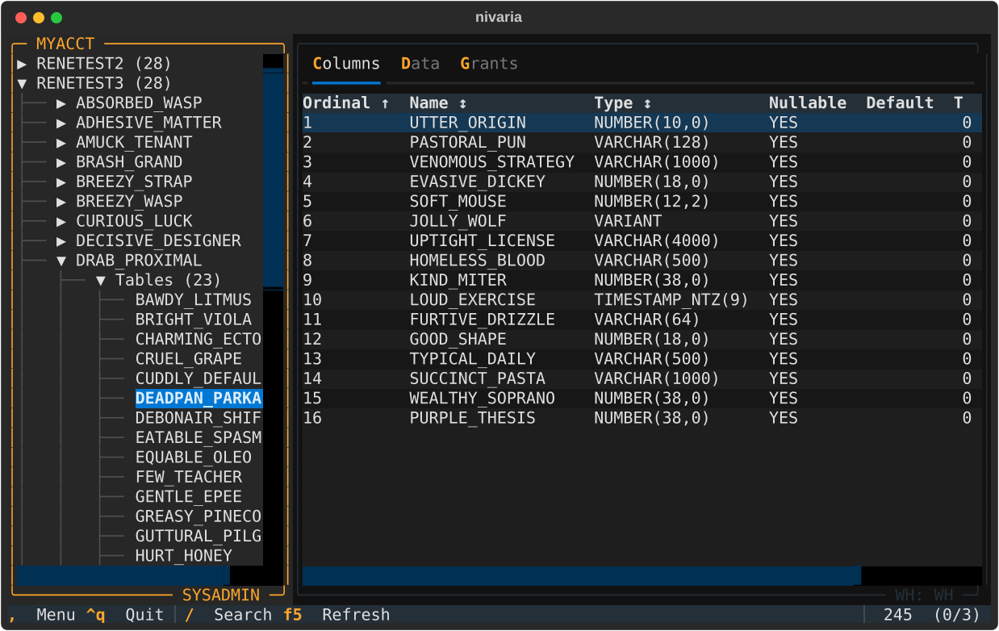

# Nivaria



> __Nivarius, nivaria, nivarium__  
> _Latin adjective_
>
> “Of snow,” “belonging to snow,” or “snow-related.” _Nivaria_ is its feminine singular form.

Nivaria is a terminal UI to browse and search objects in Snowflake: databases,
schemas, tables, views, pipes, stages and tasks, with their columns, grants,
tags, load and run history, and a preview of table data.

It reads everything from a local cache and refreshes it in the background, so
browsing and fuzzy search are instant even across thousands of objects. The
object tree comes from `SHOW` commands, which need no running warehouse, and a
small pool of connections is opened once, so an MFA-protected account prompts
at login rather than on every query.

## Install and run

```sh
uv tool install nivaria
nivaria
```

Enter your account and user in the connect dialog, pick an authenticator
(OAuth, browser SSO or password + MFA) and connect. `Ctrl+D` selects the
databases to browse, `/` searches, `F9` opens the menu.

## Caveats

- The Data tab and the activity, history and tag columns run `SELECT`s on the
  active warehouse, which consumes credits. The tree and object lists do not.
- nivaria stores no passwords; login tokens are kept by the Snowflake driver's
  own credential cache.

## Documentation

- [docs/MANUAL.md](docs/MANUAL.md) — connecting, keys, browsing, search, detail views and all settings.
- [docs/OPERATIONS.md](docs/OPERATIONS.md) — Snowflake load, warehouse and privilege needs, limits, files on disk, troubleshooting.
- [docs/DESIGN.md](docs/DESIGN.md) — architecture, core principles and the reasons behind them.
- [docs/DEVELOPMENT.md](docs/DEVELOPMENT.md) — setup, tests, linting, conventions and live-account tools.
- [docs/snowflake-behavior.md](docs/snowflake-behavior.md) — what live Snowflake accounts were observed to do.
- [docs/measurements.md](docs/measurements.md) — timings and data volumes behind the design.
